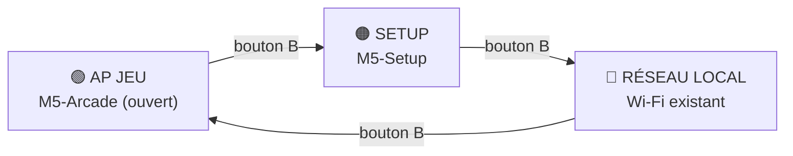

<div align="center">

# 🕹️ M5 Arcade

**Transforme un M5Stick en borne d'arcade Wi‑Fi : il héberge des jeux HTML, ouvre un portail captif et fait jouer tout le monde ensemble.**


</div>

---

## ✨ Fonctionnalités

- 🎮 **Aucun jeu préinstallé** : tout est stocké dynamiquement (mémoire flash LittleFS, ou **carte SD** pour plus de place).
- 📥 **Téléchargement depuis GitHub** : récupère les fichiers `.html` de **n'importe quel dépôt GitHub public** : tu saisis l'utilisateur et le dépôt dans la page Setup.
- 📡 **3 modes**, changés avec le bouton B : AP Jeu, Setup, Réseau local.
- 🪪 **Portail captif** : on se connecte au Wi‑Fi, le jeu s'ouvre tout seul.
- 👥 **Multijoueur** : le M5Stick sert de relais WebSocket entre les joueurs (jusqu'à 8 connexions).
- 📶 **Jusqu'à 5 réseaux Wi‑Fi** mémorisés, essayés dans l'ordre.
- 🔒 **Page d'administration** protégée par mot de passe.

## 🧭 Les 3 modes (bouton B)



| Mode | Ce qui se passe | Accès |
|---|---|---|
| **AP Jeu** | Réseau ouvert `M5-Arcade` + portail captif : toute connexion ouvre le jeu sélectionné | automatique |
| **Setup** | Réseau `M5-Setup`, portail d'administration | `http://192.168.4.1` |
| **Réseau local** | Le M5Stick rejoint ton Wi‑Fi et affiche son IP à l'écran | jeu : `http://IP/` · admin : `http://IP/setup` |

**Boutons :** `A` = jeu suivant · `A` maintenu 1,5 s = supprimer le jeu affiché · `B` = changer de mode.

## 🧰 Matériel

- Un **M5Stick** à base d'ESP32‑S3 (carte `ESP32S3 Dev Module` dans l'IDE).
- *(Optionnel)* un module **carte SD** (SPI), FAT32.

## 🚀 Installation

### 1. Bibliothèques

| Bibliothèque | Version testée | Installation |
|---|---|---|
| **M5Unified** | 0.2.25 | Gestionnaire de bibliothèques |
| **ESP Async WebServer** (auteur *ESP32Async*) | 3.12.1 | Gestionnaire de bibliothèques |
| **Async TCP** (auteur *ESP32Async*) | 3.5.0 | Gestionnaire de bibliothèques |

> ⚠️ Installe ESPAsyncWebServer et AsyncTCP **depuis le catalogue**, pas par import de ZIP : un import ZIP provoque des erreurs `undefined reference`.

### 2. Réglages de la carte

- Carte : **ESP32S3 Dev Module**
- **USB CDC On Boot** : `Enabled`
- **Partition Scheme** : un schéma avec SPIFFS (ex. `8M with spiffs`) — c'est lui qui stocke les jeux

### 3. Téléverser

Ouvre `M5_Arcade/M5_Arcade.ino`, compile, téléverse. La première compilation est longue (plusieurs minutes).

### 4. Premier démarrage

1. Bouton **B** jusqu'à **SETUP**, connecte-toi au Wi‑Fi `M5-Setup`.
2. Ouvre `http://192.168.4.1` (identifiant `admin`, mot de passe `1234` par défaut).
3. Ajoute ton réseau Wi‑Fi, renseigne ton **dépôt GitHub** (utilisateur + nom du dépôt), puis télécharge chaque jeu par son nom de fichier (ex. `pong.html`).
4. Bouton **B** → **AP JEU**, connecte un téléphone à `M5-Arcade` : le jeu s'ouvre.

## ⚙️ Configuration

Tout en haut de `M5_Arcade.ino` :

```cpp
static const char* DEF_GH_USER = "";         // dépôt GitHub par défaut (vide = à saisir dans Setup)
static const char* DEF_GH_REPO = "";
static const char* DEF_SSID    = "";         // Wi-Fi par défaut (vide = à configurer dans Setup)
static const char* DEF_SETUP   = "1234";     // mot de passe Setup par défaut
static const int SD_SCK = -1, SD_MISO = -1, SD_MOSI = -1, SD_CS = -1;  // -1 = SD désactivée
```

- **Dépôt des jeux** : saisi dans la page Setup (rubrique « Dépôt GitHub »), mémorisé dans le M5Stick. Les fichiers sont lus sur la branche `main` (ou `master`).
- **Mot de passe Setup** : à partir de 8 caractères, le Wi‑Fi `M5-Setup` devient protégé en WPA2. En dessous (comme `1234`), le Wi‑Fi est ouvert et le portail demande `admin` + mot de passe.
- **Carte SD** : renseigne les 4 broches de ton câblage. Si une SD est détectée, les jeux téléchargés y sont stockés (marqués `[SD]`).

## 👥 Multijoueur : le relais WebSocket

Le M5Stick expose `ws://<adresse>/ws` et relaie les messages entre les joueurs :

| Message | Sens | Rôle |
|---|---|---|
| `I<n>` | M5 → joueur | ton numéro de place (0 à 7) |
| `C<masque>` | M5 → tous | joueurs présents (un bit par place) |
| `texte` | joueur → tous les autres | relayé tel quel |
| `@<n>\|texte` | joueur → place `n` | livré uniquement à ce joueur |

Exemple minimal côté jeu :

```js
let me = -1, mask = 0;
const ws = new WebSocket("ws://" + location.host + "/ws");
ws.onmessage = e => {
  const m = e.data;
  if (m[0] === "I") me = +m.slice(1);        // ma place
  else if (m[0] === "C") mask = +m.slice(1); // joueurs connectés
  else onMessage(m);                          // messages des autres joueurs
};
ws.send("mon message");                       // vers tous les autres
ws.send("@0|mon message");                    // uniquement vers la place 0
```

Convention : les jeux multijoueurs ont un nom en `…2.html` (ex. `pong2.html`) ou sont indiqués dans le dépôt des jeux.

## 🛠️ Dépannage

| Symptôme | Cause / solution |
|---|---|
| `undefined reference to AsyncWebServerRequest::…` | Bibliothèques importées en ZIP : supprime-les et prends celles du catalogue |
| Écran bleu/noir en boucle | Plantage au démarrage : téléverse la dernière version, puis ouvre le moniteur série (115200) |
| `192.168.4.1` ne répond pas | Vérifie que l'appareil est bien sur `M5-Setup` (pas en Ethernet/VPN) et utilise `http://` |
| Téléchargement GitHub en échec | Vérifie le nom du fichier (casse comprise) et que le Wi‑Fi a accès à internet |
| Pas de port série dans l'IDE | Maintiens reset ~2 s (mode téléchargement) puis réessaie |

## 🗂️ Structure

```
M5_Arcade/
└── M5_Arcade.ino      # tout le firmware (serveur web, DNS captif, WebSocket, GitHub, SD)
```

## 🌍 Open source

**Ce projet est 100 % open source, et c'est notre priorité.** Le firmware comme les jeux sont publics et le resteront. Le code est libre : tu peux l'utiliser, l'étudier, le modifier et le partager, en classe, en club, à la maison ou ailleurs. Les contributions sont les bienvenues : propose une amélioration, signale un bug ou ajoute ton propre jeu via une *issue* ou une *pull request*.

## 📜 Licence et mentions légales

- **Licence MIT** : texte complet ci‑dessous. Le logiciel est fourni « tel quel », sans garantie d'aucune sorte ; les auteurs ne peuvent être tenus responsables de son utilisation.
- **Remerciements** : ce projet a été réalisé avec l'aide de **Claude**, l'assistant d'intelligence artificielle développé par [Anthropic](https://www.anthropic.com), qui a participé à l'écriture du code et de la documentation. Un grand merci à lui. Le code généré a été relu, testé et adopté par les auteurs, qui en restent responsables.
- **Marques** : « Claude » et « Anthropic » sont des marques de leur propriétaire. Leur mention ici n'implique aucun partenariat, affiliation ou parrainage.
- Les noms de matériel et de bibliothèques cités (M5Stack, M5Stick, ESP32, Arduino…) appartiennent à leurs propriétaires respectifs.

<details>
<summary>📄 Texte complet de la licence MIT</summary>

```text
MIT License

Copyright (c) 2026 LBJudo

Permission is hereby granted, free of charge, to any person obtaining a copy
of this software and associated documentation files (the "Software"), to deal
in the Software without restriction, including without limitation the rights
to use, copy, modify, merge, publish, distribute, sublicense, and/or sell
copies of the Software, and to permit persons to whom the Software is
furnished to do so, subject to the following conditions:

The above copyright notice and this permission notice shall be included in all
copies or substantial portions of the Software.

THE SOFTWARE IS PROVIDED "AS IS", WITHOUT WARRANTY OF ANY KIND, EXPRESS OR
IMPLIED, INCLUDING BUT NOT LIMITED TO THE WARRANTIES OF MERCHANTABILITY,
FITNESS FOR A PARTICULAR PURPOSE AND NONINFRINGEMENT. IN NO EVENT SHALL THE
AUTHORS OR COPYRIGHT HOLDERS BE LIABLE FOR ANY CLAIM, DAMAGES OR OTHER
LIABILITY, WHETHER IN AN ACTION OF CONTRACT, TORT OR OTHERWISE, ARISING FROM,
OUT OF OR IN CONNECTION WITH THE SOFTWARE OR THE USE OR OTHER DEALINGS IN THE
SOFTWARE.
```

</details>

<div align="center">Fait avec ❤️ en open source, pour jouer ensemble, sans internet.</div>
